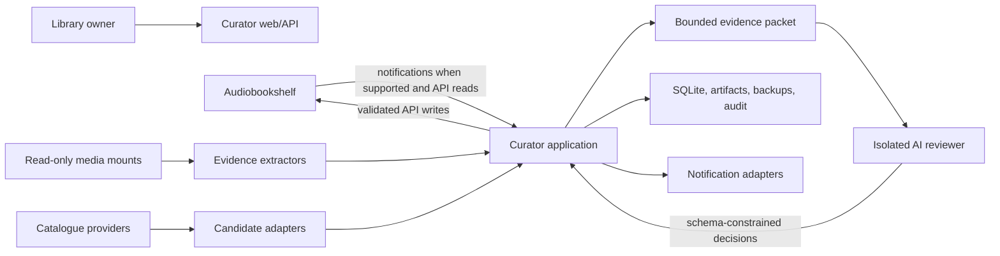

# Architecture Overview

## Context

Mechanical Librarian runs beside one or more media-library services. It observes
items, gathers local and remote evidence, asks an AI reviewer for structured
field-level decisions, applies permitted changes through supported APIs, and
verifies production state.

The normal installation is one container. Internal process and privilege
boundaries preserve security without exposing deployment complexity.

## System context



## Container model

One image contains two long-lived security principals and transient extraction
tools:

```text
container
├── supervisor
├── curator process
│   ├── HTTP API and static dashboard
│   ├── event listener and scheduler
│   ├── persisted job executor
│   ├── evidence and provider orchestration
│   └── validation, apply, verification, rollback
├── AI runner process
│   └── Codex CLI or another configured reviewer
└── transient parsers
    ├── ffprobe
    └── bounded ebook extractors
```

The curator principal can read configured media mounts and service credentials.
The AI principal can read only staged evidence, approved images, its own
authentication state, and its output directory. It cannot read production
media, the main database, backups, or service secrets.

## Logical layers

### Domain

Owns vocabulary, invariants, state machines, decisions, policies, and pure
business rules. It has no framework, network, filesystem, database, provider,
or AI dependencies.

### Application

Owns use cases such as inventory reconciliation, evidence collection, proposal
resolution, review, apply preparation, verification, and rollback. It depends
on domain types and ports.

### Adapters

Translate external services into application-owned contracts:

- library services;
- metadata and cover providers;
- AI reviewers;
- notification systems;
- clocks, identifiers, storage, and task execution.

### Infrastructure

Provides SQLite persistence, migrations, HTTP server, process supervision,
filesystem access, structured logging, configuration, metrics, and packaging.

### Interfaces

HTTP, dashboard, CLI, health endpoints, and future plugin surfaces invoke the
same application services. They do not duplicate policy or write logic.

## Core workflows

### Discovery

1. Accept a service event or reconciliation result.
2. Persist the raw event with a deduplication key.
3. Load the current item through the service adapter.
4. Compute and persist a canonical fingerprint.
5. Schedule evidence work only when the item is new, changed, unresolved, or
   selected by policy.

### Decision

1. Extract bounded content, path, current-state, and provider evidence.
2. Normalize evidence into field proposals.
3. Resolve deterministic no-ops, incompatibilities, and contradictions.
4. Stage only the required evidence for the AI reviewer.
5. Validate the returned schema and evidence references.
6. Apply deterministic policy to produce `auto_apply`, `needs_review`, or
   `closed_rejected` disposition.

### Apply

1. Confirm write capability and backup readiness.
2. Acquire the service and item locks.
3. Reload the current item and compare its fingerprint.
4. Back up current item metadata and cover evidence.
5. Apply a bounded, field-level change through the supported API.
6. Read back and verify expected state.
7. Record success or attempt rollback and trip the circuit breaker.

## Reliability model

- SQLite is the source of truth for jobs and workflow state.
- Events are at-least-once; handlers must be idempotent.
- Every external side effect has an idempotency key or precondition.
- Jobs are leased and recoverable after process death.
- Network and provider failures are retryable states, not evidence.
- Current-state drift supersedes stale proposals rather than overwriting newer
  user or service changes.
- A circuit breaker disables writes without disabling discovery or reporting.

## Extension model

Adapters declare capabilities. The domain does not assume that all services or
AI backends support every field or action. New adapters must pass the common
contract suite and may add adapter-specific tests without forking core policy.

Plugin loading is not required for the first release. Prefer explicit,
statically registered adapters until configuration, compatibility, and security
contracts have stabilized.
