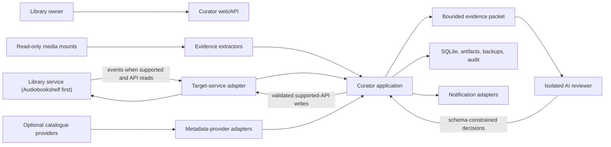

# Architecture Overview

## Context

Mechanical Librarian runs beside one or more media-library services.
Audiobookshelf is the first supported production target, but the application-
owned contracts are not shaped around Audiobookshelf. It observes items,
gathers local and remote evidence, asks an AI reviewer for structured
field-level decisions, applies permitted changes through supported APIs, and
verifies production state.

The normal installation is one container. Internal process and privilege
boundaries preserve security without exposing deployment complexity.

## System context



## Container model

One image contains two long-lived security principals and transient extraction
tools:

```text
container
├── supervisor
├── curator process
│   ├── HTTP API and bundled web interface
│   ├── event listener and scheduler
│   ├── persisted job executor
│   ├── evidence and provider orchestration
│   └── validation, apply, verification, rollback
├── AI runner process
│   └── Codex CLI or another configured reviewer
└── transient parsers
    ├── ffprobe
    └── bounded ebook extractors
```

The curator principal can read configured media mounts and service credentials.
The AI principal can read only staged evidence, approved images, its own
authentication state, and its output directory. It cannot read production
media, the main database, backups, or service secrets.

## Logical layers

### Domain

Owns vocabulary, invariants, state machines, decisions, policies, and pure
business rules. It has no framework, network, filesystem, database, provider,
or AI dependencies.

### Application

Owns use cases such as inventory reconciliation, evidence collection, proposal
resolution, review, apply preparation, verification, and rollback. It depends
on domain types and ports.

### Adapters

Translate external services into application-owned contracts:

- library services;
- metadata and cover providers;
- AI reviewers;
- notification systems;
- clocks, identifiers, storage, and task execution.

The planned curation boundary separates five roles:

1. target-service adapters observe current service state and, when separately
   authorized, perform supported-API mutations;
2. local evidence extractors read bounded content and media facts without
   becoming target or catalogue clients;
3. metadata-provider adapters return optional remote evidence without target
   credentials or mutation access; they receive only an application-built,
   bounded, allowlisted `ProviderQuery`, their own scoped credential, and an
   independently restricted network client;
4. deterministic domain policy evaluates evidence sufficiency, candidates,
   contradictions, and disposition; and
5. reviewer backends return bounded recommendations without discovering
   evidence, changing policy, or receiving write authority.

These roles use application/domain-owned ports and canonical schemas. Opaque
external identities remain scoped to their adapter, connection, library, and
schema version; vendor payload fields do not enter target, snapshot, evidence,
candidate, proposal, reviewer-packet, decision, or apply-plan contracts.
Raw vendor semantics stay inside the owning adapter. An external item value may
cross only as an uninterpreted `ExternalItemId` member of its fully scoped
canonical `TargetId`, never as a free or unscoped identifier.

### Infrastructure

Provides SQLite persistence, migrations, HTTP server, process supervision,
filesystem access, structured logging, configuration, metrics, and packaging.

### Interfaces

HTTP, dashboard, CLI, health endpoints, and future plugin surfaces invoke the
same application services. They do not duplicate policy or write logic.

## Core workflows

### Discovery

1. Accept a service event or reconciliation result.
2. Persist the raw event with a deduplication key.
3. Load the current item through the target-service adapter into the canonical
   inventory contract.
4. Compute and persist a canonical fingerprint.
5. Schedule evidence work only when the item is new, changed, unresolved, or
   selected by policy.

### Decision

1. Extract bounded content and path evidence, retain the canonical current-state
   observation, and derive each lane from the capabilities relevant to its role:
   inventory from target and scope; local evidence from target, media, field,
   and extractor; provider evidence from target, media, field, provider, query,
   and configuration; and candidates from completed relevant evidence plus
   policy.
2. Normalize evidence into field proposals.
3. Resolve deterministic no-ops, incompatibilities, and contradictions.
4. Stage only the required evidence for the AI reviewer.
5. Validate the returned schema and evidence references.
6. Apply deterministic policy to produce `auto_apply`, `needs_review`, or
   `closed_rejected` disposition.

The canonical current snapshot is authoritative for what the scoped target was
observed to contain and for no-op detection, optimistic concurrency, planning,
and verification. It is one versioned bibliographic observation, not privileged
bibliographic truth. Providerless report-only operation remains a planned valid
flow: inventory, local evidence, deterministic no-op and rejection handling,
bounded proposals, and human review do not require a catalogue provider.

The narrower 0.2 title preview uses the same application-owned seams but F09a
constructs all three inputs inside a closed synthetic harness: an in-memory
Audiobookshelf-shaped title snapshot, exactly one eligible `TITLE` from the real
F06 child reading an application-generated EPUB, and one candidate from a
provider-neutral port. F09a supplies a deterministic fake; F09b's separate
`hardcover-title-proposal-report` substitutes bounded Hardcover for only the
generated `agree-empty` case and is disabled when its optional secret-file
reference is omitted. It changes no `config-v1` field. Agreement creates
at most one `needs_review` proposal whose value is the exact F06
`normalized_value`; F06 `raw_value` remains evidence/provenance and provider
evidence only corroborates. A current title field that is present and loaded
with an empty value is a valid fill-empty case, and a materially different
current title remains eligible. A missing, unloaded, or unavailable current
title, equivalence, disagreement, an empty or unusable F06/provider title, or
another unavailable input records a typed no-proposal result without hiding
valid local evidence. Immutable versioned sets replay
identical inputs and supersede changed inputs. F10 persists one current
immutable proposal set containing exactly one current `needs_review` title
proposal as one undecided case; no other proposal or set creates a case. AI,
human decisions, covers, rich fields, multi-provider fusion, and writes remain
outside the preview.

The harness persists only identity-bound `synthetic_preview` sets with derived
false production applicability and a separate synthetic current pointer. It
never adds rows to inventory history or current inventory pointers, and it has
no review or apply adapter. Connecting a configured media item and current live
snapshot to F06 is a later application use case, not an implicit adapter hidden
inside F09a.

F09b ordinary automation uses a credential-free structural fake through the
same adapter seam. Completion also requires the exact installed artifact to
parse one bounded real-endpoint result without a parser or compatibility
failure, retaining only redacted aggregate evidence. Production provider
configuration, persisted work, freshness/reuse, restart behavior, and live-
target binding remain F09f scope.

### Apply

1. Confirm write capability and backup readiness.
2. Acquire the service and item locks.
3. Reload the current item and compare its fingerprint.
4. Back up current item metadata and cover evidence.
5. Apply a bounded, field-level change through the supported API.
6. Read back and verify expected state.
7. Record success or attempt rollback and trip the circuit breaker.

## Reliability model

- SQLite is the source of truth for jobs and workflow state.
- Events are at-least-once; handlers must be idempotent.
- Every external side effect has an idempotency key or precondition.
- Jobs are leased and recoverable after process death.
- Network and provider failures are retryable states, not evidence.
- Current-state drift supersedes stale proposals rather than overwriting newer
  user or service changes.
- A circuit breaker disables writes without disabling discovery or reporting.

## Extension model

Adapters declare capabilities. Lane applicability uses the intersection for
that lane role rather than one global checklist or service/provider names:
inventory uses target and scope; local evidence uses target, media, field, and
extractor; provider evidence uses target, media, field, provider, query, and
configuration; candidate lanes use completed relevant evidence and policy. A
dimension irrelevant to a lane is absent, not an unsatisfied capability.
Provider configuration,
declared capability, execution outcome, and evidence result are orthogonal: an
unconfigured or unsupported provider is not a failed call, and a failed or empty
call is not negative metadata evidence. The domain does not assume that all
services, providers, extractors, or AI backends support every field or action.
New adapters must pass the common contract suite and may add adapter-specific
tests without forking core policy.

Plugin loading is not required for the first release. Prefer explicit,
statically registered adapters until configuration, compatibility, and security
contracts have stabilized. A future extension contract must declare typed
capabilities, configuration and secret requirements, compatibility bounds,
resource and network permissions, health metrics, and automatic-suspension
behavior. A manifest is descriptive only; enforceable isolation must exist
before third-party code can receive secrets or execute in a production
process.
